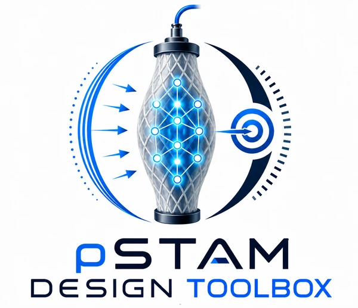
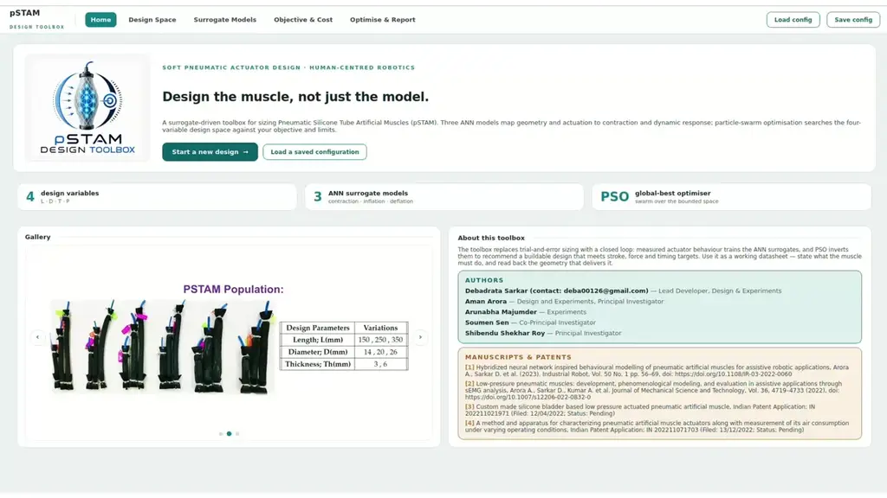
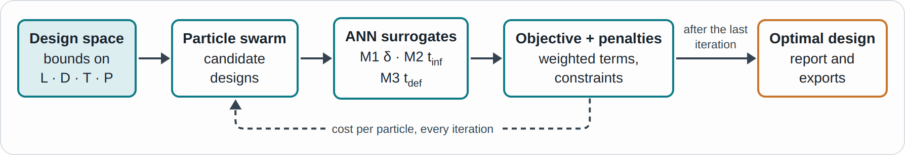
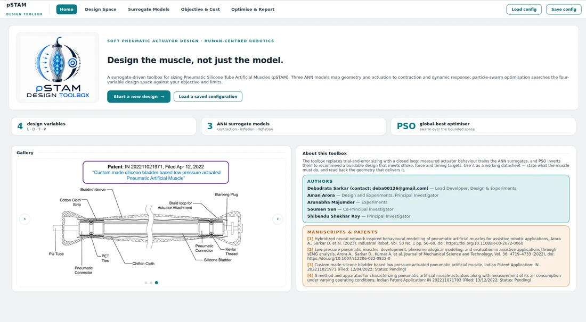
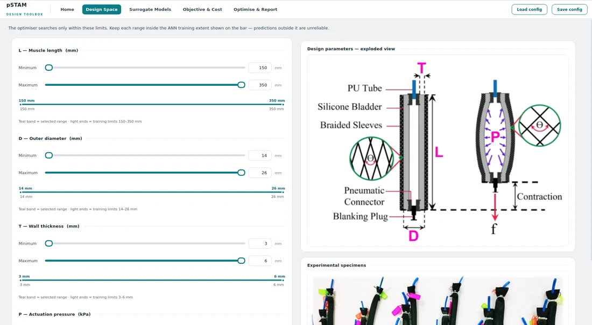
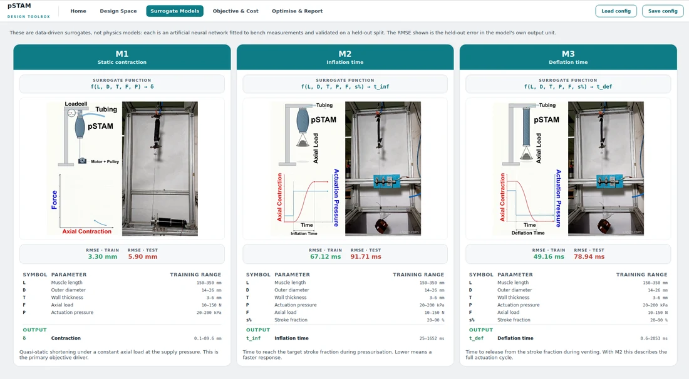
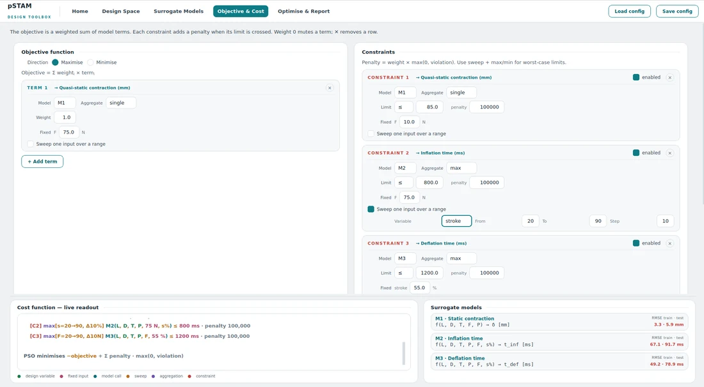
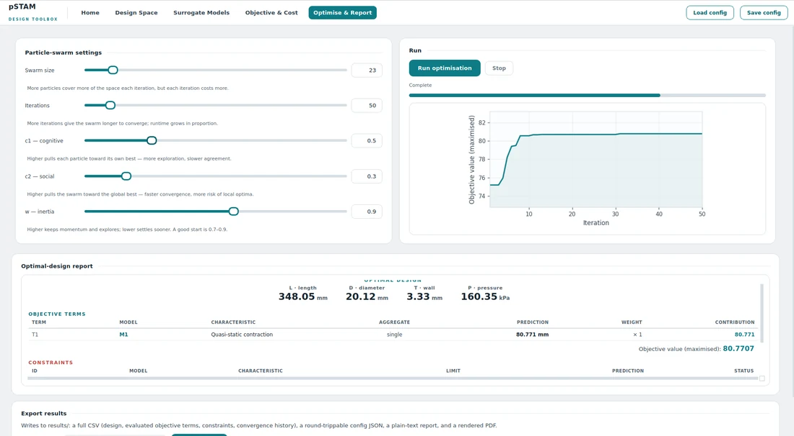

<p align="center">
  
</p>

<h1 align="center">pSTAM Design Toolbox</h1>

<p align="center">
  <b>Data-driven design of Pneumatic Silicone Tube Artificial Muscles (pSTAMs):<br>
  ANN surrogate-based behavioural modelling of pSTAMs,<br>
  followed by inverse design optimisation through particle swarm optimisation (PSO)</b>
</p>

<p align="center">
  <a href="https://doi.org/10.1108/IR-03-2022-0060"></a>
  <a href="https://doi.org/10.1007/s12206-022-0832-0"></a>
  <a href="#citation"></a>
  
  
  
  <a href="LICENSE"></a>
  <a href="LICENSE-CC-BY-NC-4.0.txt"></a>
</p>

<p align="center">
  <b><a href="https://www.linkedin.com/in/debadrata-sarkar">Debadrata Sarkar</a></b><sup>1</sup> &nbsp;·&nbsp;
  <b>Soumen Sen</b><sup>1</sup> &nbsp;·&nbsp;
  <b>Shibendu Shekhar Roy</b><sup>2</sup> &nbsp;·&nbsp;
  <b><a href="https://www.linkedin.com/in/dr-aman-arora/">Aman Arora</a></b><sup>1</sup><br>
  <sub><sup>1</sup>Human-Centred Robotics and Cybernetics Group, CSIR-Central Mechanical Engineering Research Institute (CSIR-CMERI), Durgapur, India</sub><br>
  <sub><sup>2</sup>National Institute of Technology Durgapur, India</sub>
</p>

<p align="center">
  <a href="mailto:deba00126@gmail.com"></a>
  <a href="https://www.linkedin.com/in/debadrata-sarkar"></a>
  <a href="https://dsarkarrobotics.com"></a>
</p>

<p align="center">
  <a href="#overview"><b>Overview</b></a> &nbsp;•&nbsp;
  <a href="#how-it-works"><b>How it works</b></a> &nbsp;•&nbsp;
  <a href="#the-five-tabs"><b>The five tabs</b></a> &nbsp;•&nbsp;
  <a href="#installation"><b>Installation</b></a> &nbsp;•&nbsp;
  <a href="#quick-start"><b>Quick start</b></a> &nbsp;•&nbsp;
  <a href="#citation"><b>Citation</b></a> &nbsp;•&nbsp;
  <a href="#contact"><b>Contact</b></a>
</p>

<p align="center">
  <br>
  <sub><i>From the Home tab to the optimal-design report: bound the design space, inspect the surrogates, state the objective and constraints, run the swarm and export the design.</i></sub>
</p>

---

## Overview

Pneumatic artificial muscles are compliant, light and inherently safe, which makes them attractive for assistive and rehabilitative wearable robots. Sizing one, however, is still largely trial and error: contraction, force and response time depend non-linearly on the muscle's geometry, its supply pressure and the load it carries.

The **pSTAM Design Toolbox** closes that loop for **Pneumatic Silicone Tube Artificial Muscles (pSTAM)**. Three artificial neural network (ANN) surrogates, trained on characterisation data of custom-fabricated pSTAMs, predict how a muscle of a given geometry will behave. You state what the muscle must do (maximise or minimise a weighted combination of those behaviours, subject to limits), and particle swarm optimisation (PSO) searches the four design variables for the muscle that does it.

<table>
  <tr>
    <td width="33%" valign="top">🎯 <b>Inverse design</b><br><sub>State the required behaviour; read back length, diameter, wall thickness and pressure.</sub></td>
    <td width="33%" valign="top">🧠 <b>Validated surrogates</b><br><sub>Three ANNs for static contraction, inflation time and deflation time, with train and test RMSE in the interface.</sub></td>
    <td width="33%" valign="top">⚖️ <b>Composable objectives</b><br><sub>Weighted multi-term objectives, worst-case or mean behaviour over a load or stroke sweep, and penalised constraints.</sub></td>
  </tr>
  <tr>
    <td width="33%" valign="top">🐝 <b>Particle swarm search</b><br><sub>PySwarms global-best PSO with every swarm parameter exposed and a live convergence plot.</sub></td>
    <td width="33%" valign="top">📄 <b>Complete export</b><br><sub>CSV, a round-trippable JSON configuration, a plain-text report and a rendered PDF for every design.</sub></td>
    <td width="33%" valign="top">🖥️ <b>No coding needed</b><br><sub>A five-tab desktop interface, plus a command-line entry point for scripted runs.</sub></td>
  </tr>
</table>

## How it works

<p align="center">
  
</p>

**Design variables**, the quantities the swarm searches:

| Symbol | Variable | Unit | Training range |
|:--:|:--|:--:|:--:|
| L | Muscle length | mm | 150–350 |
| D | Outer diameter | mm | 14–26 |
| T | Wall thickness | mm | 3–6 |
| P | Actuation pressure | kPa | 20–200 |

**Operating inputs**, held fixed or swept over a range inside each objective term and constraint: the axial load **F** (10–150 N) and, for the timing models, the stroke fraction **s%** (20–90 %).

**Surrogate models**

| Model | Predicts | Surrogate function | Output range | RMSE train · test |
|:--:|:--|:--|:--:|:--:|
| **M1** | Static contraction | δ = f(L, D, T, F, P) | 0.1–89.6 mm | 3.30 · 5.90 mm |
| **M2** | Inflation time | t<sub>inf</sub> = f(L, D, T, P, F, s%) | 25–1652 ms | 67.12 · 91.71 ms |
| **M3** | Deflation time | t<sub>def</sub> = f(L, D, T, P, F, s%) | 8.6–2853 ms | 49.16 · 78.94 ms |

RMSE is read at runtime from the stored network weights in `data/`. The networks are evaluated with a plain NumPy forward pass, so no deep-learning framework is required. The characterisation and behavioural modelling of these actuators are described in [[1]](#citation) and [[2]](#citation).

**Objective and constraints.** Each objective term evaluates one surrogate, optionally sweeps F or s% over a range and aggregates the predictions by `single`, `mean`, `min` or `max`. The terms combine as a weighted sum,

$$J(\mathbf{x}) = \sum_i w_i \, \mathrm{agg}_i\big(M_i(\mathbf{x}, \ldots)\big), \qquad \mathbf{x} = [L,\ D,\ T,\ P],$$

which is maximised or minimised. Each enabled constraint compares its aggregated prediction *y* with a threshold *y*<sub>lim</sub> and adds a penalty *k* · max(0, *y* − *y*<sub>lim</sub>) for a "≤" limit, or *k* · max(0, *y*<sub>lim</sub> − *y*) for a "≥" limit.

## The five tabs

<sub>Click any screenshot to open it at full resolution.</sub>


<table>
  <tr>
    <td width="50%" valign="top">
      <a href="assets/readme/tab_1_home.png"></a><br>
      <b>1 · Home:</b> overview, the experimental gallery, authors, the underlying manuscripts and patents, and loading a saved configuration.
    </td>
    <td width="50%" valign="top">
      <a href="assets/readme/tab_2_design_space.png"></a><br>
      <b>2 · Design Space:</b> set the search bounds on L, D, T and P against the surrogates' training limits.
    </td>
  </tr>
  <tr>
    <td width="50%" valign="top">
      <a href="assets/readme/tab_3_surrogate_models.png"></a><br>
      <b>3 · Surrogate Models:</b> M1, M2 and M3 with their inputs, training ranges, outputs, train and test RMSE, and the experiment behind each.
    </td>
    <td width="50%" valign="top">
      <a href="assets/readme/tab_4_objective_cost.png"></a><br>
      <b>4 · Objective &amp; Cost:</b> compose objective terms and constraints, with a live, colour-coded readout of the resulting cost function.
    </td>
  </tr>
  <tr>
    <td colspan="2" align="center" valign="top">
      <a href="assets/readme/tab_5_optimise_report.png"></a><br>
      <b>5 · Optimise &amp; Report:</b> tune the swarm, run it, follow convergence, read the optimal-design report and export it.
    </td>
  </tr>
</table>

## Installation

**Requirements:** Python **3.10 or 3.11** and about 400 MB of disk space for the virtual environment. Tested on Windows, x86-64 Linux and an NVIDIA Jetson AGX Orin (JetPack 6, Ubuntu 22.04, ARM64). macOS has not been tested.

The dependencies are split in two files because the GUI toolkit, PyQt5, is installed differently on ARM64 Linux:

| File | Contents | Use on |
|:--|:--|:--|
| `requirements.txt` | NumPy, SciPy, pandas, PySwarms, matplotlib | every platform |
| `requirements-desktop.txt` | `requirements.txt` + PyQt5 from PyPI | Windows and x86-64 Linux |

> [!IMPORTANT]
> Use Python 3.10 or 3.11. The pinned NumPy 1.x stack (NumPy 1.23.5, SciPy 1.10.1, pandas 1.5.3) has no prebuilt wheels for Python 3.12 or newer, and PyPI has no ARM64 Linux wheel for PyQt5. On a Jetson, PyQt5 comes from `apt` instead.

<details open>
<summary><b>Windows (PowerShell)</b></summary>

```powershell
git clone https://github.com/debadrata/pSTAM-Design-Toolbox.git
cd pSTAM-Design-Toolbox
py -3.11 -m venv .venv
.venv\Scripts\Activate.ps1
python -m pip install --upgrade pip
pip install -r requirements-desktop.txt
```

If PowerShell refuses to run `Activate.ps1`, allow local scripts once with
`Set-ExecutionPolicy -Scope CurrentUser RemoteSigned`, or use Command Prompt and run `.venv\Scripts\activate.bat` instead.
</details>

<details>
<summary><b>Linux x86-64</b></summary>

```bash
git clone https://github.com/debadrata/pSTAM-Design-Toolbox.git
cd pSTAM-Design-Toolbox
python3.11 -m venv .venv
source .venv/bin/activate
python -m pip install --upgrade pip
pip install -r requirements-desktop.txt
```

On a minimal Ubuntu install, PyQt5 may also need `sudo apt install libxcb-xinerama0 libxcb-cursor0`.
</details>

<details>
<summary><b>NVIDIA Jetson and other ARM64 Linux (Ubuntu 22.04)</b></summary>

```bash
sudo apt update
sudo apt install python3-pyqt5 python3.10-venv
git clone https://github.com/debadrata/pSTAM-Design-Toolbox.git
cd pSTAM-Design-Toolbox
python3.10 -m venv --system-site-packages .venv
source .venv/bin/activate
python -m pip install --only-binary=:all: -r requirements.txt
```

- `python3-pyqt5` is Ubuntu's prebuilt PyQt5 for the system Python 3.10, which is why the environment is created with `python3.10`.
- `--system-site-packages` lets the virtual environment see that system PyQt5; everything else is installed inside `.venv`.
- `--only-binary=:all:` makes pip use prebuilt ARM64 wheels and stop with a clear error instead of attempting a long source build.
</details>

No Git? Use **Code → Download ZIP** on this page, extract it and run the same commands from the extracted folder.

## Quick start

```bash
python gui_app_qt.py
```

1. **Design Space:** keep the default bounds, or narrow them to the geometries you can fabricate.
2. **Surrogate Models:** check which inputs each model needs and how accurate it is.
3. **Objective & Cost:** choose *Maximise* or *Minimise*, add objective terms and constraints, and confirm the live cost readout says what you mean.
4. **Optimise & Report:** set the swarm size and iterations, press **Run optimisation**, and read the optimal design.
5. **Save results:** four files are written to `results/` under the name you enter.

Use **Save config** and **Load config** in the top bar to keep and reload a complete set-up as JSON.

### Outputs

| File | Contents |
|:--|:--|
| `<name>.csv` | Optimal design, every evaluated objective term and constraint, and the convergence history |
| `<name>_config.json` | The full configuration; reload it with **Load config** |
| `<name>_report.txt` | Plain-text report |
| `<name>_report.pdf` | Formatted report with the convergence plot |

### Command line

For scripted or batch runs, edit `get_default_config()` in `config.py` and run:

```bash
python run_optimization.py
```

The result is printed to the terminal and written to `results/pstam_result_<timestamp>.csv`.

## Repository structure

```text
pSTAM-Design-Toolbox/
├── gui_app_qt.py             # the toolbox interface (run this)
├── run_optimization.py       # command-line optimisation using config.py
├── config.py                 # default configuration and its schema
├── pstam/
│   ├── ann.py                # NumPy forward pass of the M1, M2 and M3 surrogates
│   ├── objective.py          # objective terms, sweeps, aggregation, constraint penalties
│   └── optimizer.py          # PySwarms global-best PSO driver
├── data/
│   ├── M1_weights.csv        # trained network weights and train/test error
│   ├── M2_weights.csv
│   ├── M3_weights.csv
│   └── normalisation.xlsx    # reference only; not read at runtime
├── assets/                   # images and clips shown in the interface
│   └── readme/               # media used only on this page
├── results/                  # exports are written here
├── requirements.txt          # core dependencies (all platforms)
├── requirements-desktop.txt  # core + PyQt5 for Windows and x86-64 Linux
├── SETUP_AND_RUN.txt         # offline setup notes
├── CITATION.cff
├── LICENSE                   # code license: PolyForm Noncommercial 1.0.0
├── LICENSE-CC-BY-NC-4.0.txt  # content license: CC BY-NC 4.0
└── NOTICE                    # copyright and which license applies to what
```

<details>
<summary><b>Troubleshooting</b></summary>

| Symptom | Fix |
|:--|:--|
| `ModuleNotFoundError: No module named 'PyQt5'` | The virtual environment is not active, or the install step was skipped. On Windows and x86-64 Linux install `requirements-desktop.txt`; on a Jetson install `python3-pyqt5` with apt and create the environment with `--system-site-packages`. |
| pip tries to build PyQt5 from source (`sip`, `qmake` errors) on ARM64 | PyPI has no ARM64 Linux wheel for PyQt5. Follow the Jetson instructions: PyQt5 from apt, then `requirements.txt` only. |
| `pip` tries to build NumPy from source and fails | The environment uses Python 3.12 or newer. Recreate it with Python 3.10 or 3.11. |
| `could not load the Qt platform plugin "xcb"` (Linux) | `sudo apt install libxcb-xinerama0 libxcb-cursor0` |
| No convergence plot or PDF report | matplotlib is missing. It is optional, and both requirements files install it. |
| The window is larger than the screen | Pages scroll horizontally and vertically when they cannot fit; maximise the window for the best layout. |

</details>

## Citation

The actuator, its characterisation and the behavioural models behind this toolbox are described in the following manuscripts and patents. If the toolbox helps your work, please cite [1] and [2].

**Manuscripts**

**[1]** A. Arora, D. Sarkar, A. Majumder, S. Sen and S. S. Roy, "Hybridized neural network inspired behavioural modelling of pneumatic artificial muscles for assistive robotic applications," *Industrial Robot*, vol. 50, no. 1, pp. 56–69, 2023. doi: [10.1108/IR-03-2022-0060](https://doi.org/10.1108/IR-03-2022-0060)

**[2]** A. Arora, D. Sarkar, A. Kumar, S. Sen and S. S. Roy, "Low-pressure pneumatic muscles: development, phenomenological modeling, and evaluation in assistive applications through sEMG analysis," *Journal of Mechanical Science and Technology*, vol. 36, no. 9, pp. 4719–4733, 2022. doi: [10.1007/s12206-022-0832-0](https://doi.org/10.1007/s12206-022-0832-0)

**Patents**

**[3]** A. Arora, D. Sarkar, S. Sen and C. Har, "Custom made silicone bladder based low pressure actuated pneumatic artificial muscle," Indian Patent **No. 604983** (Application No. 202211021971), filed 12 April 2022, granted 5 October 2026. Patentee: Council of Scientific and Industrial Research.

**[4]** "A method and apparatus for characterizing pneumatic artificial muscle actuators along with measurement of its air consumption under varying operating conditions," Indian Patent Application **IN 202211071703**, filed 13 December 2022 (pending).

```bibtex
@article{arora2023hybridized,
  title   = {Hybridized neural network inspired behavioural modelling of pneumatic
             artificial muscles for assistive robotic applications},
  author  = {Arora, Aman and Sarkar, Debadrata and Majumder, Arunabha and
             Sen, Soumen and Roy, Shibendu Shekhar},
  journal = {Industrial Robot},
  volume  = {50},
  number  = {1},
  pages   = {56--69},
  year    = {2023},
  doi     = {10.1108/IR-03-2022-0060}
}

@article{arora2022lowpressure,
  title   = {Low-pressure pneumatic muscles: development, phenomenological modeling,
             and evaluation in assistive applications through {sEMG} analysis},
  author  = {Arora, Aman and Sarkar, Debadrata and Kumar, Amit and
             Sen, Soumen and Roy, Shibendu Shekhar},
  journal = {Journal of Mechanical Science and Technology},
  volume  = {36},
  number  = {9},
  pages   = {4719--4733},
  year    = {2022},
  doi     = {10.1007/s12206-022-0832-0}
}

@misc{arora2026siliconepam,
  title        = {Custom made silicone bladder based low pressure actuated
                  pneumatic artificial muscle},
  author       = {Arora, Aman and Sarkar, Debadrata and Sen, Soumen and Har, Chandan},
  howpublished = {Indian Patent No. 604983 (Application No. 202211021971)},
  year         = {2026},
  note         = {Filed 12 April 2022; granted 5 October 2026; patentee:
                  Council of Scientific and Industrial Research}
}

@software{sarkar2026pstamtoolbox,
  title   = {{pSTAM Design Toolbox}},
  author  = {Sarkar, Debadrata and Sen, Soumen and Roy, Shibendu Shekhar and
             Arora, Aman},
  year    = {2026},
  url     = {https://github.com/debadrata/pSTAM-Design-Toolbox}
}
```

GitHub's **Cite this repository** button (right-hand sidebar) gives the same software entry from `CITATION.cff`.

## License

Copyright © 2026 CSIR-Central Mechanical Engineering Research Institute (CSIR-CMERI), Durgapur, India.

| Part of the repository | License |
|:--|:--|
| Source code (all `.py` files) | [PolyForm Noncommercial License 1.0.0](LICENSE) |
| Everything else: documentation, images, animations, logo, diagrams and the files in `data/` | [Creative Commons Attribution-NonCommercial 4.0 International (CC BY-NC 4.0)](LICENSE-CC-BY-NC-4.0.txt) |

Both licenses allow noncommercial use only; for commercial use, please get in touch through the [contact](#contact) details below. The actuator and its characterisation apparatus are covered by the granted patent and the patent application listed under [Citation](#citation). Neither license grants rights to make, use or sell that hardware: the patent license in the PolyForm terms covers only patent claims infringed by using the software itself. See [`NOTICE`](NOTICE) for the full statement.

## Contact

**[Debadrata Sarkar](https://www.linkedin.com/in/debadrata-sarkar)**, lead developer, design and experiments<br>
Human-Centred Robotics and Cybernetics Group, CSIR-CMERI, Durgapur, India<br>
📧 [deba00126@gmail.com](mailto:deba00126@gmail.com) &nbsp;·&nbsp; 💼 [LinkedIn](https://www.linkedin.com/in/debadrata-sarkar) &nbsp;·&nbsp; 🌐 [dsarkarrobotics.com](https://dsarkarrobotics.com)

**[Aman Arora](https://www.linkedin.com/in/dr-aman-arora/)**, design and experiments, principal investigator<br>
Human-Centred Robotics and Cybernetics Group, CSIR-CMERI, Durgapur, India<br>
📧 [aman.cmeri@nic.in](mailto:aman.cmeri@nic.in) &nbsp;·&nbsp; 🏛️ [CSIR-CMERI profile](https://www.cmeri.res.in/user-details/1413) &nbsp;·&nbsp; 💼 [LinkedIn](https://www.linkedin.com/in/dr-aman-arora/)

For bugs and questions about the code, please [open an issue](https://github.com/debadrata/pSTAM-Design-Toolbox/issues) so the answer helps the next person too.
